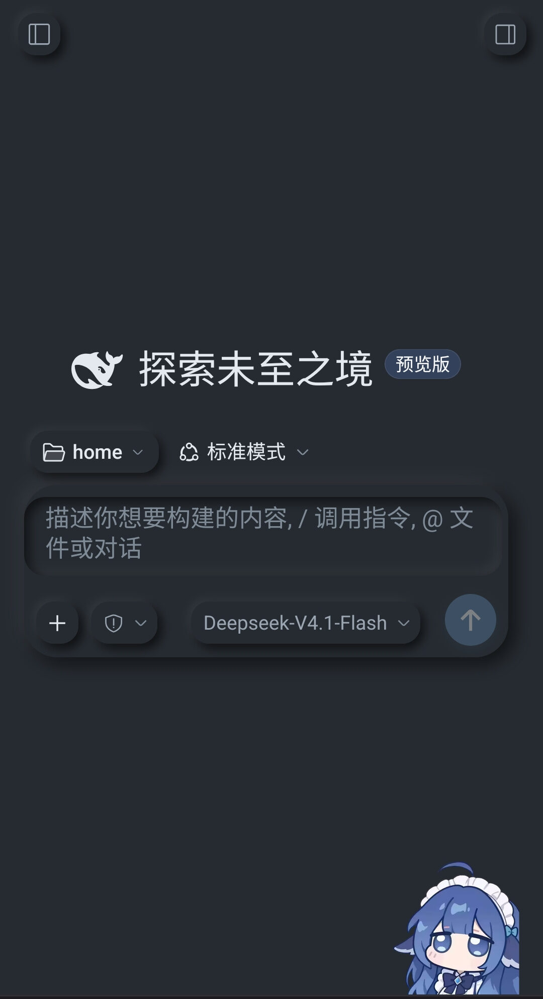
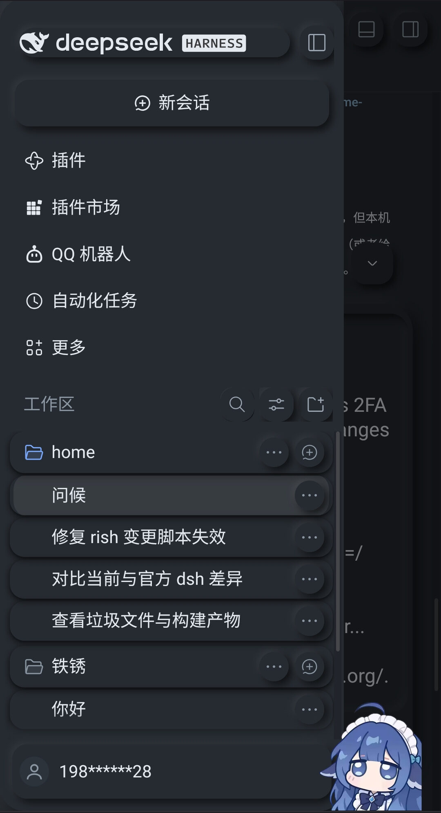

# DSH 新拟态主题 (dsh-theme-neumorph)

[](https://github.com/wcnmamrs/dsh-theme-neumorph/actions/workflows/ci.yml)
[](https://www.npmjs.com/package/dsh-theme-neumorph)
[](LICENSE)

给 Harness 网页界面换上一层**新拟态**（neumorphism / soft UI）皮肤：冷灰表面、钢蓝强调色、柔和的单向与双向软阴影，浅色与深色模式同时生效。

## 截图

深色模式（浅色模式同一套配色，换成 `#e0e5ec` 冷灰底）：

| 首页与输入区 | 侧栏与会话列表 |
| --- | --- |
|  |  |

## 它做了什么

主题由两层组成，彼此独立、都可回退：

| 层 | 手段 | 作用 |
| --- | --- | --- |
| 颜色层 | `ctx.theme.overrideTokens()` | 覆盖 72 个 `--dsw-*` 颜色与圆角 token：表面、按钮填充、代码面板、浮动层、边框、文字、品牌色、状态色、圆角刻度 |
| 阴影层 | 注入一张 `<style>` | 新拟态必须靠成对的软阴影表达，而 token 只能装颜色，所以阴影单独成表 |

配色基线：

- 冷灰 `#e0e5ec` 系表面，钢蓝 `#4a6b8a` 强调（深色模式自动切换为 `#262b31` / `#7ea6c9`）
- 高光 `rgba(163,177,198,.6)` 与暗部 `#ffffff` 组成双缘阴影；深色模式改用低透明度白光与深黑

浮雕只落在四处：卡片柔和投影、输入区内凹、输入区大板与菜单/对话框的双向浮雕、侧栏沟槽。整宽、背景透明的控件（列表行、菜单项、分段控件）不带投影——它们一旦带投影，会在圆角之外画出一条“幻影边线”，看起来像多余的边框。

## 边界

主题只动宿主自己画的界面，不碰第三方插件：

- 宿主的类名是 CSS Module 的 `<hash>_<local>` 形式，规则按整类名锚定（如 `[class$="_card"]`），不会误伤卡片内部的零件。
- 每条子串锚定（`[class*="_title"]` 这类）都带 `:not([class*="__"])`：宿主是**单**下划线，别人家的 BEM 是**双**下划线，这一条挡住的正是 `block__title`。
- 没有一条规则按裸标签生效：`span` 不被当成文字，`button` 不被当成按钮。允许的唯一例外是宿主的表单与代码面（`textarea`、`input`、`select`、`pre`），测试会逐条核对。
- 文本框的焦点指示不用宿主的外扩轮廓（在软表面上像一圈多余的蓝边），改成画在框内侧的 1.5px 钢蓝内缘——键盘用户仍然看得到光标落在哪个框。

## 目录结构

```
.
├── package.json           # bundle 清单: dsh.bundle.patch + dsh.client
├── cordis.patch.yml       # 把本插件 insert 进 profile 的 Loader 树
├── index.js               # Host 半: 空实现,只作为 bundle 的一行存在
├── client.js              # Client 半: token 覆盖 + 阴影样式表
├── locale/{zh,en}.json    # 插件列表里的标题与描述
├── icon.svg               # 原创图标
├── test/                  # 不依赖浏览器的断言
│   ├── harness.mjs        #   按 __ModuleLoader__ 契约加载 client.js
│   └── theme.test.mjs     #   调色板 / 样式表结构 / 卸载路径
├── scripts/
│   └── verify-manifest.mjs # 清单与打包自检
└── .github/workflows/ci.yml
```

## 实现要点

- Client 半通过 `window.__ModuleLoader__.load({ id, factory })` 注册，`factory` 返回 `{ inject: ['theme'], apply(ctx) }`。
- 所有副作用都包在 `ctx.effect()` 里并返回清理函数，插件停用时撤销 token 覆盖层并移除样式表，界面立刻回到原生外观。
- 若宿主某天拒绝含 `--dsw-radius-*` 的 token 表，会自动退回只含颜色的 66 项重试。
- 样式规则用整类名锚定宿主 CSS Module，哈希前缀随版本变化也不会失效。

## 开发

不需要浏览器，也不需要安装依赖（`node --test` 自带）：

```bash
npm test                    # 7 项断言：调色板、样式表结构、卸载路径
npm run check               # 语法检查
node scripts/verify-manifest.mjs   # 清单/打包自检
npm run verify              # 以上全部
```

测试用一个假的 `window.__ModuleLoader__` 与 `document` 载入 `client.js`，因此断言的正是宿主实际调用的那条路径。其中三条是这次踩过坑之后加的护栏：

- 样式表里不允许出现裸标签选择器（`body span`、`body button`），
- 不允许出现第三方插件命名（曾经把 `dshwv-*` 的图标清空），
- 卡片只允许整类名锚定，不允许 `[class*="_card"]` 这种会命中 `_cardContent` 的子串锚定。

## 许可

MIT
